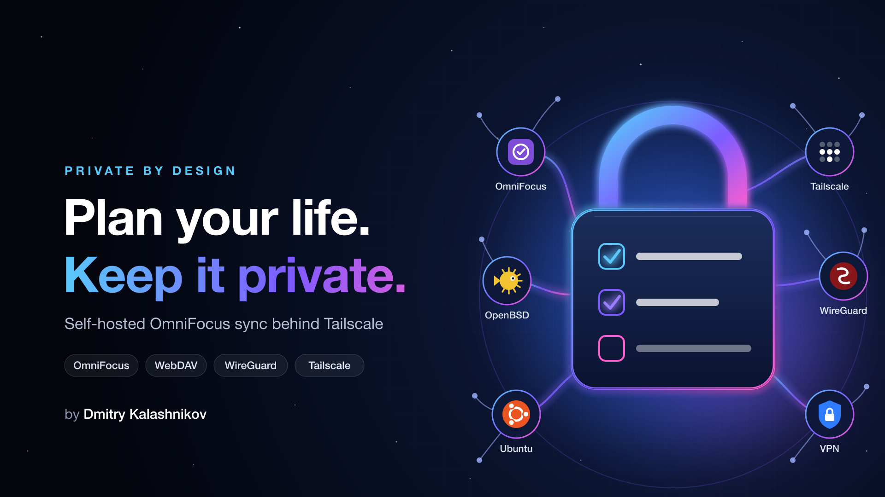
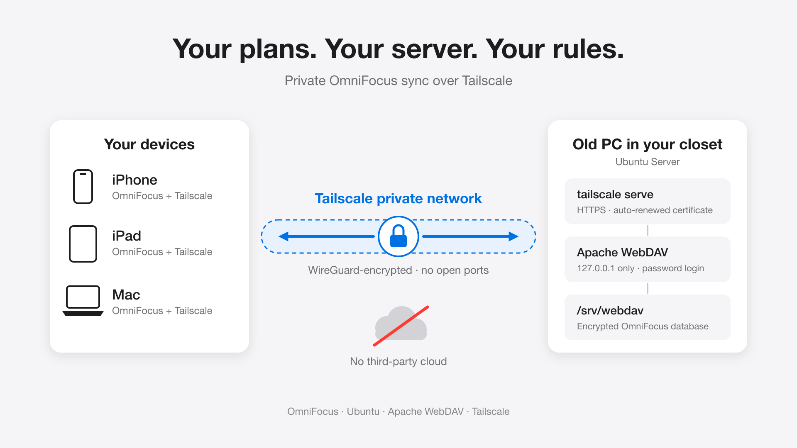

# How to Plan Your Life and Keep Your Data Private

Your to-do list knows more about you than your diary.

It knows the doctor you need to call, the money you owe, the job you're quietly interviewing for, the conversation you keep putting off, and the goals you haven't told anyone about yet.

So here's a question worth asking: **where does that list live, and who else can see it?**

## Twenty years of trying every system

I love being organized. Over the last two decades I've tried nearly every planning method and tool out there:

- **Methodologies:** David Allen's *Getting Things Done* (GTD), mind mapping, time blocking, and more paper-and-pencil systems than I can count.
- **Software:** mind-mapping tools like XMind, polished task managers like Things, and plenty of others.

They all taught me something. But one tool stuck: **OmniFocus**.

## Why OmniFocus

Life isn't a flat list. "Renovate the kitchen" contains "pick a contractor," which contains "get three quotes," which contains "call Dave back about the tile."

OmniFocus lets you nest folders, projects, and action groups as deep as you need. That means I can break any goal, however big or vague, down into the next physical action I can take today. Combine that with tags, defer dates, and custom perspectives, and you get a system that fits how your brain actually works instead of forcing your brain to fit the app.

## Why privacy matters to me

I've run OpenBSD, the most secure operating system, for about twenty years. I care about privacy and security, especially in the age of AI.

Most task apps sync through their vendor's cloud. That's convenient, but it means your most personal data sits on someone else's servers, under their retention policy, their outage schedule, and their terms of service.

OmniFocus has a feature most people never notice: **it can sync to your own server** using WebDAV, an open standard. No vendor account required.

To be fair to Omni: OmniFocus already encrypts your database on your device, with a key protected by your sync password, before it syncs anywhere, including Omni's own sync service. That's a great default. Self-hosting goes one step further:

- **No third party stores your data at all**, not even encrypted.
- **You control backups and retention.** Nothing is deleted or migrated on someone else's timeline.
- **The server isn't on the public internet.** It's reachable only from your own devices.

## The setup TLDR

> An old computer at home runs a tiny WebDAV server that's invisible to the internet, and your phone and laptop reach it through a private encrypted network.



Here's what you need:

| Piece | What it does | Cost |
|---|---|---|
| An old PC, mini PC, or Raspberry Pi | Stores your OmniFocus database | Whatever's in your closet |
| Ubuntu Server or OpenBSD | The operating system | Free |
| Apache with WebDAV | The sync server OmniFocus talks to | Free |
| Tailscale | Private network between your devices, built on WireGuard | Free personal plan |
| OmniFocus | Your planning app | Paid app |

### Why Tailscale?

To sync from your phone or laptop at a coffee shop, your devices need a way to reach the box at home. The traditional answer, port forwarding on your router, exposes your server to every scanner on the internet.

Tailscale creates a private network (a "tailnet") between your devices. Under the hood it uses **WireGuard**, a modern, audited, high-performance VPN protocol. Your server never opens a port to the public internet. Only devices logged into your tailnet can see it.

Tailscale also gives each machine a stable name (like `drive.your-tailnet.ts.net`) and can issue a real HTTPS certificate for it, so OmniFocus connects over properly validated TLS with no self-signed certificate warnings.

## Step-by-step guide

I packaged the whole server setup into short, readable shell scripts, one set per operating system. Everything is on GitHub: **[github.com/klimb/omnifocus-private](https://github.com/klimb/omnifocus-private)**

> **A rule I live by:** never run a shell script from the internet that you haven't read. These scripts are short on purpose. Read them first.

### Pick your path

| | Path A: Ubuntu Server | Path B: OpenBSD |
|---|---|---|
| Best for | Getting it running fast | Maximum security |
| Why | Huge community, runs on almost any hardware | Minimal, audited, secure by default |
| Admin tool | `sudo` | `doas` |
| Installer | [`./Ubuntu/install.sh`](https://github.com/klimb/omnifocus-private/blob/main/Ubuntu/install.sh) | [`./OpenBSD/install.sh`](https://github.com/klimb/omnifocus-private/blob/main/OpenBSD/install.sh) |
| Data lives in | `/srv/webdav` | `/var/webdav` |

Both paths end up in the same place: Apache WebDAV listening only on the server itself, published to your tailnet over HTTPS with `tailscale serve`.

### 1. Prepare the server

**Path A: Ubuntu Server**

1. Install **Ubuntu Server** on your spare machine.
2. Create a user with `sudo` and enable SSH.
3. Install Tailscale and log in:

   ```bash
   curl -fsSL https://tailscale.com/install.sh | sh
   sudo tailscale up
   ```

   (Read it first, or use the package instructions at tailscale.com/download.)

**Path B: OpenBSD**

OpenBSD's motto says it all: *"Only two remote holes in the default install, in a heck of a long time!"* Use a 64-bit x86 or ARM machine.

1. Install **OpenBSD** and say yes to starting `sshd` during setup.
2. Let your user use `doas`. The installer already adds the user it creates to the `wheel` group, so as root run:

   ```sh
   echo 'permit persist :wheel' > /etc/doas.conf
   ```

3. Install Tailscale from the official packages and log in:

   ```sh
   doas pkg_add tailscale
   doas rcctl enable tailscaled
   doas rcctl start tailscaled
   doas tailscale up
   ```

### 2. Configure your tailnet

In the Tailscale admin console under **DNS**, turn on:

- **MagicDNS** gives your machines friendly names.
- **HTTPS Certificates** lets Tailscale issue a valid TLS certificate for your server.

One honest caveat: certificates are recorded in public Certificate Transparency logs, so your machine name and tailnet name become publicly visible. Your data doesn't. Just don't name your server something revealing.

### 3. Run the installer from your laptop

Clone the [repo](https://github.com/klimb/omnifocus-private) on a computer that's on your tailnet and can SSH into the server:

```bash
git clone https://github.com/klimb/omnifocus-private.git
cd omnifocus-private
```

Then run the installer for your path:

```bash
# Path A: Ubuntu
./Ubuntu/install.sh drive         # replace "drive" with your server's tailnet name
./Ubuntu/install.sh drive alice   # optionally pass the sync username

# Path B: OpenBSD
./OpenBSD/install.sh puffy        # replace "puffy" with your server's tailnet name
./OpenBSD/install.sh puffy alice  # optionally pass the sync username
```

You'll be prompted on the server for your `sudo` or `doas` password and then for a new OmniFocus sync password. The password is typed directly into the server's terminal. It never appears in command arguments or shell history, and it's stored only as a bcrypt hash.

What the script does (read it yourself: [Ubuntu](https://github.com/klimb/omnifocus-private/blob/main/Ubuntu/setup-remote.sh), [OpenBSD](https://github.com/klimb/omnifocus-private/blob/main/OpenBSD/setup-remote.sh)):

1. **Checks Tailscale** is running, with MagicDNS and HTTPS certificates enabled.
2. **Installs Apache** with its WebDAV modules (`apt` on Ubuntu, `pkg_add` on OpenBSD).
3. **Binds Apache to `127.0.0.1:8080` only**, so it can't be reached from your home network directly, let alone the internet.
4. **Creates the storage folder** (`/srv/webdav/omnifocus` on Ubuntu, `/var/webdav/omnifocus` on OpenBSD) with tight permissions.
5. **Stores your login** as a bcrypt hash in `/etc/apache2/webdav.htpasswd`.
6. **Publishes it to your tailnet** with `tailscale serve`, which handles HTTPS with an auto-renewing certificate.
7. **Verifies everything works.** Anonymous requests must be rejected (401) and your login must succeed (207).

When it finishes, it prints your server address:

```
https://<server>.<your-tailnet>.ts.net/omnifocus/
```

Re-running the script is safe. It's also how you change your password.

### 4. Connect OmniFocus

Every device needs Tailscale installed and connected. On iPhone and iPad, turn on **VPN On Demand** in the Tailscale app so sync just works in the background.

**On your main Mac first:**

1. Open **OmniFocus → Settings → Sync**.
2. Set **Sync with** to **WebDAV Server**.
3. Enter the server address, username, and password.
4. Click **Sync**. Your existing database is uploaded to your new, empty server.

**Then on every other device:** use the same settings. When OmniFocus asks, choose to use the **server's** database and replace the local copy.

That's it. You now have a private sync server for your whole life plan.

### 5. Back it up

A private server means *you* are the backup department. Back up `/srv/webdav` (Ubuntu) or `/var/webdav` (OpenBSD) regularly with restic, borg, or a simple rsync to another drive. Because OmniFocus encrypts the database with your sync password, your backups are encrypted too.

## Bonus: moving from Things to OmniFocus

Coming from Things 3? The repo includes [`things-to-omnifocus.js`](https://github.com/klimb/omnifocus-private/blob/main/things-to-omnifocus.js), a Mac script that copies your areas, projects, tags, and to-dos, including your completed logbook, into OmniFocus.

```bash
osascript -l JavaScript things-to-omnifocus.js           # dry run: shows what it would import
osascript -l JavaScript things-to-omnifocus.js --apply   # actually import
```

Always do the dry run first.

## Want maximum control?

Tailscale is the easy path. Your traffic is end-to-end encrypted with WireGuard, but Tailscale's coordination service still manages which devices belong to your network. If you want zero third parties involved:

- **Self-host the coordination server** with Headscale, an open-source Tailscale control server.
- **Or skip Tailscale entirely:** configure WireGuard by hand. OpenBSD has it built into the kernel.

More control means more work. Pick the level that matches your threat model.

## The takeaway

Planning your life well and keeping your life private aren't opposing goals. With an old computer, a free private network, and an afternoon, you can have both:

- A planning system as deep as your ambitions
- Sync across all your devices
- Data that lives in **your** house, on **your** hardware, under **your** rules

Your to-do list is the blueprint of your life. Keep it somewhere you trust.

**Get the scripts:** [github.com/klimb/omnifocus-private](https://github.com/klimb/omnifocus-private)

*How do you keep your personal data private? I'd love to hear your setup in the comments.*

#Productivity #Privacy #OmniFocus #GTD #SelfHosting #Tailscale #WireGuard #CyberSecurity